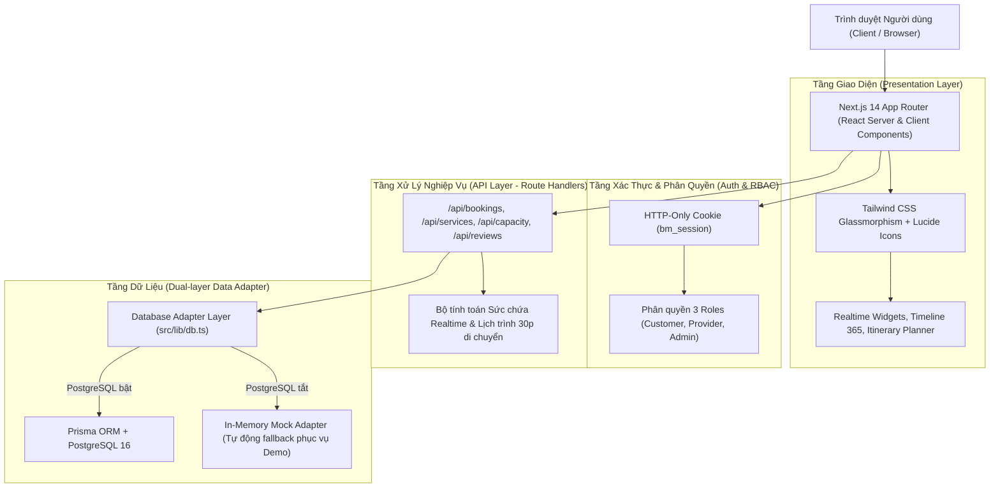
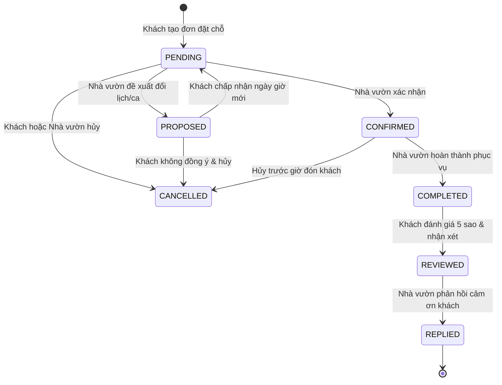

# Kiến Trúc Hệ Thống (System Architecture)

**Bình Mỹ Wellness Web** là nền tảng số kết nối du lịch sinh thái nông nghiệp, trải nghiệm miệt vườn và nghỉ dưỡng ven sông Sài Gòn tại Xã Bình Mỹ, Huyện Củ Chi, TP. Hồ Chí Minh.

---

## 🏗 Tổng Quan Kiến Trúc (Architecture Overview)

Dự án được xây dựng theo kiến trúc hiện đại hướng hiệu năng, bảo mật và trải nghiệm tương tác trực quan cao:



---

## 🔄 Vòng Đời Đơn Đặt Chỗ (Booking State Machine)

Hệ thống xử lý chu trình đặt chỗ và phục vụ khách theo mô hình máy trạng thái khép kín:



---

## 📂 Cấu Trúc Thư Mục Chuẩn (Directory Layout)

```
BinhMyWellnessWeb/
├── .github/                      # GitHub Actions CI/CD, templates và quy chuẩn cộng đồng
│   ├── workflows/                # Workflows: CI, Commitlint, PR Labeler
│   ├── ISSUE_TEMPLATE/           # Mẫu báo cáo lỗi và yêu cầu tính năng
│   ├── PULL_REQUEST_TEMPLATE.md  # Mẫu Pull Request
│   ├── CODE_OF_CONDUCT.md        # Bộ quy tắc ứng xử
│   ├── CONTRIBUTING.md           # Hướng dẫn đóng góp mã nguồn
│   ├── SECURITY.md               # Chính sách an toàn bảo mật
│   └── SUPPORT.md                # Kênh hỗ trợ
├── prisma/                       # Schema cơ sở dữ liệu quan hệ (PostgreSQL)
│   └── schema.prisma             # Định nghĩa bảng User, Service, Booking, Review, AuditLog
├── public/                       # Tài nguyên tĩnh (ảnh danh lam Bình Mỹ, Củ Chi, icons)
├── scripts/                      # Script tự động hóa
│   ├── seed.mjs                  # Nạp dữ liệu mẫu ban đầu vào PostgreSQL
│   └── test_flow.mjs             # End-to-End test tự động hóa toàn bộ luồng nghiệp vụ
├── src/
│   ├── app/                      # Next.js 14 App Router
│   │   ├── admin/                # Bảng điều khiển Quản trị viên
│   │   ├── api/                  # REST API endpoints (Auth, Bookings, Services, Reviews)
│   │   ├── customer/             # Bảng quản lý đơn hàng của Khách
│   │   ├── experiences/[id]/     # Trang chi tiết trải nghiệm nhà vườn
│   │   ├── itinerary/            # Bộ lập kế hoạch hành trình 1 ngày tự động
│   │   ├── login/                # Trang đăng nhập
│   │   ├── provider/             # Bảng điều phối dành cho Chủ cơ sở nhà vườn
│   │   ├── layout.tsx            # Root Layout kèm thanh chuyển đổi vai trò 1-chạm
│   │   └── page.tsx              # Trang chủ (Hero, Timeline 365, Sơ đồ sinh thái, Danh sách)
│   ├── components/               # Các React Component dùng chung
│   └── lib/                      # Các tiện ích, hằng số, bộ xử lý DB adapter
├── .gitattributes                # Quy định chuẩn hóa định dạng dòng (LF/CRLF)
├── .gitignore                    # Bỏ qua tệp nhạy cảm và build artifacts
├── BRANCHING.md                  # Quy chuẩn phân nhánh Git
├── commitlint.config.js          # Cấu hình kiểm tra cú pháp commit
├── docker-compose.yml            # Môi trường chạy PostgreSQL 16 containerized
└── README.md                     # Tài liệu giới thiệu và hướng dẫn tổng quan dự án
```

---

## 🛡 Bảo Mật & Xác Thực (Security & Auth)

- **Session Management**: Sử dụng Cookie `bm_session` với cờ `HttpOnly`, `SameSite=Lax`, `Path=/` ngăn chặn tấn công XSS.
- **Mã Hóa**: Toàn bộ mật khẩu người dùng được hash 1 chiều bằng thuật toán `bcryptjs` với salt rounds chuẩn.
- **RBAC (Role-Based Access Control)**:
  - Khách hàng (`CUSTOMER`): Chỉ xem và quản lý đơn đặt của bản thân, viết đánh giá cho trải nghiệm đã hoàn tất.
  - Nhà vườn (`PROVIDER`): Quản lý tiếp nhận, xác nhận, đổi lịch hoặc hoàn thành dịch vụ thuộc cơ sở mình.
  - Ban quản trị (`ADMIN`): Kiểm duyệt dịch vụ, kích hoạt/tạm dừng nhà vườn, giám sát Audit Logs và lưu lượng truy cập.
