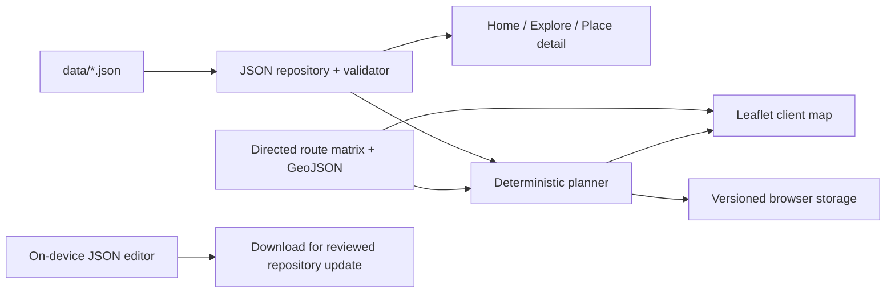

# Kiến trúc Bình Mỹ Du Ký Website

## Nguyên tắc

- Next.js 14 App Router, TypeScript, Tailwind, React và Leaflet.
- JSON trong `data/` là nguồn nội dung lúc build. Runtime chỉ đọc; Vercel Function không ghi ngược vào repository.
- Không database, xác thực, API đặt chỗ, Gemini, chatbot hoặc dịch vụ routing bắt buộc.
- Engine xác định tính khả thi từ dữ liệu đã xác minh. Thứ hạng không thay thế điều kiện cứng.
- localStorage có phiên bản và chỉ giữ sở thích/hành trình không nhạy cảm trên thiết bị hiện tại.

## Dữ liệu

`places.json` tách thông tin nhận dạng, địa bàn, địa chỉ, tọa độ và vận hành thành các trạng thái riêng. `experiences.json` ghi hoạt động, thời lượng, lịch, phù hợp tuổi và quy tắc giá. `sources.json` nêu nguồn, phạm vi và ngày kiểm tra. `images.json` phân biệt tư liệu nghiên cứu với ảnh được quyền xuất bản. `routing/matrix.json` lưu cạnh có hướng; `routes.geojson` lưu geometry.

Validator từ chối ID trùng, tham chiếu mồ côi, ngày/giờ sai, tọa độ ngoài miền, giá không phải VND nguyên, geometry thiếu, cạnh trùng và ảnh không có quyền. Script trước build kiểm tra các file ảnh nghiên cứu/xuất bản thực sự tồn tại.

## Planner

Planner kiểm tra ngày theo `Asia/Ho_Chi_Minh`, người lớn/trẻ em và tuổi, ngân sách cả nhóm hoặc từng người, giá theo người lớn/trẻ em/nhóm, sức chứa được ghi nhận, lịch, thời lượng, nghỉ trưa, phương tiện và từng cạnh có hướng. Cạnh thiếu làm tuyến không khả thi. Không có hình học thì không vẽ đường giả.

Không có bộ dữ liệu thực tế đủ điều kiện để sinh tuyến hiện nay. Fixture kiểm thử nằm trong `scripts/`, không được nhập vào dữ liệu website.

## Phần cũ

`legacy/` lưu mã ứng dụng database/auth cũ và Prisma migration để bảo toàn lịch sử dự án. `tsconfig`, route tree, package scripts và workflow CI không dùng chúng. Không chạy migration hoặc kết nối database.
