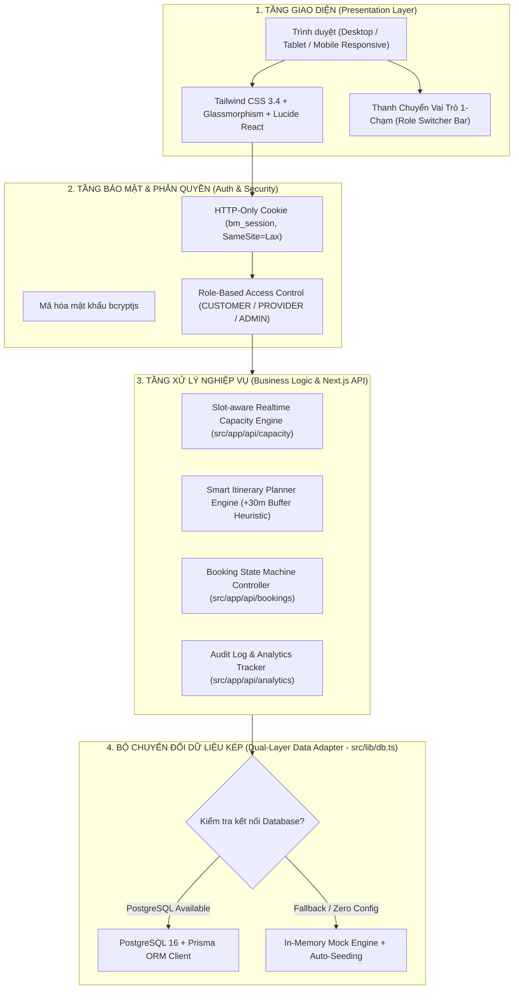
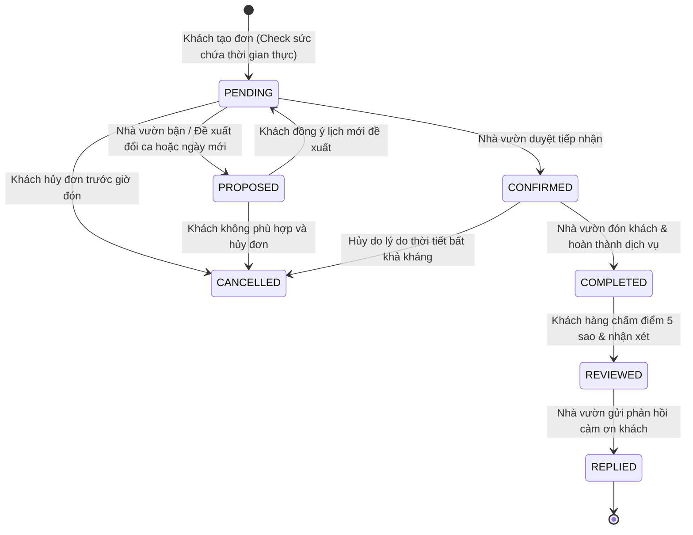
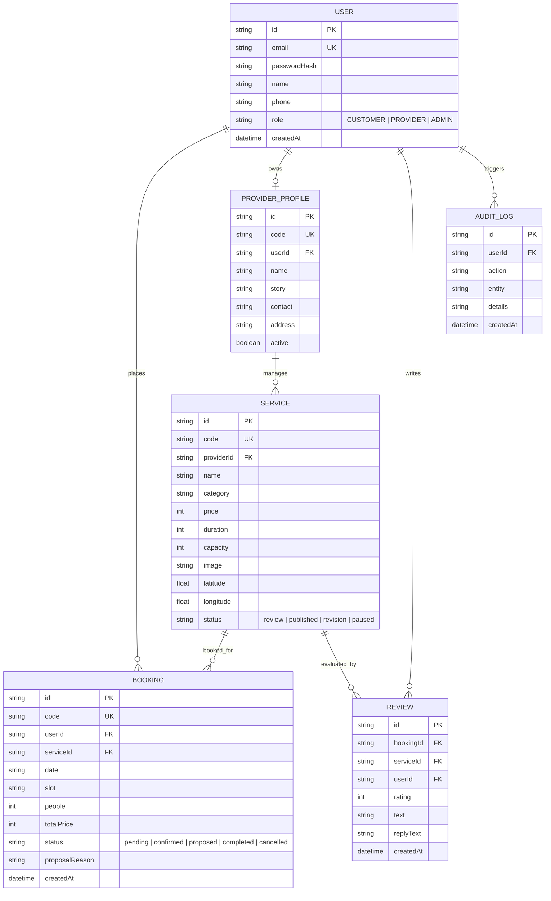

<div align="center">

# 🌿 BÌNH MỸ WELLNESS WEB
### Nền Tảng Chuyển Đổi Số Du Lịch Sinh Thái Nông Nghiệp & Miệt Vườn Ven Sông Sài Gòn
**Xã Bình Mỹ, Huyện Củ Chi, Thành phố Hồ Chí Minh**

---

<p align="center">
  <a href="https://github.com/NguyenTriBaoThang/BinhMyWellnessWeb/actions/workflows/ci.yml">
    
  </a>
  <a href="https://github.com/NguyenTriBaoThang/BinhMyWellnessWeb/stargazers">
    
  </a>
  <a href="./LICENSE">
    
  </a>
  <a href="./.github/SECURITY.md">
    
  </a>
  <a href="https://conventionalcommits.org">
    
  </a>
</p>

<p align="center">
  
  
  
  
  
  
  
</p>

<p align="center">
  <a href="#-tổng-quan--tầm-nhìn-dự-án">Tổng Quan</a> •
  <a href="#-mục-lục-table-of-contents">Mục Lục</a> •
  <a href="#-kiến-trúc-hệ-thống--công-nghệ-cốt-lõi">Kiến Trúc</a> •
  <a href="#-danh-mục-8-cơ-sở-đối-tác-nhà-vườn-bình-mỹ">8 Đối Tác Nhà Vườn</a> •
  <a href="#-tính-năng-chi-tiết-hoàn-chỉnh">Tính Năng</a> •
  <a href="#-danh-mục-api-toàn-diện-rest-api-reference">Tài Liệu API</a> •
  <a href="#-hướng-dẫn-cài-đặt--khởi-chạy">Cài Đặt</a> •
  <a href="#-kiểm-thử-tự-động--ci-pipeline">Kiểm Thử</a> •
  <a href="./ARCHITECTURE.md">ARCHITECTURE.md</a> •
  <a href="./.github/CONTRIBUTING.md">CONTRIBUTING.md</a>
</p>

</div>

---

## 🌾 TỔNG QUAN & TẦM NHÌN DỰ ÁN

### 1. Bối cảnh địa phương: Xã Bình Mỹ - Củ Chi
**Xã Bình Mỹ** là xã cửa ngõ phía Đông Nam của Huyện Củ Chi, trải dài dọc theo bờ hữu ngạn sông Sài Gòn, tiếp giáp trực tiếp với Thành phố Thủ Dầu Một (Bình Dương) qua cầu Phú Cường và kết nối thuận tiện với trung tâm TP. Hồ Chí Minh qua trục Tỉnh lộ 9 (Đường Hà Duy Phiên).

Bình Mỹ sở hữu hệ sinh thái tự nhiên độc đáo:
- **Dòng sông Sài Gòn và hệ thống rạch nhánh tự nhiên** (Kênh Rạch Dứa, Rạch Bến Đò...) bồi đắp phù sa quanh năm.
- **Vành đai nông nghiệp đô thị sinh thái**: Nông trại rau muống nước sạch VietGAP, vườn bưởi da xanh Chú Sáu, làng nghề mai vàng truyền thống Bình Mỹ và các đầm sen tự nhiên ngát hương dọc tuyến Võ Văn Bích.
- **Không gian văn hóa - tín ngưỡng Nam Bộ**: Đình Thần Bình Mỹ, các di tích lịch sử ven sông cùng kết nối liền mạch với Khu truyền thống Cách mạng Đền Bến Dược và Địa đạo Củ Chi anh hùng.

### 2. Thách thức thực tiễn & Nhu cầu số hóa
Trước khi có nền tảng số, hoạt động du lịch tại Bình Mỹ gặp phải những rào cản lớn:
1. **Quá tải cục bộ và xung đột sức chứa**: Khách du lịch thường dồn về cùng một khung giờ cuối tuần, gây quá tải cho các nhà vườn có quy mô đón tiếp giới hạn (15 - 30 khách/ca), làm giảm chất lượng trải nghiệm sinh thái.
2. **Thiếu tính toán khoảng cách & lịch trình**: Du khách tự phát khó sắp xếp thứ tự tham quan hợp lý giữa các điểm nông trại, đầm sen, vườn cây ăn trái và bến sông ngắm hoàng hôn.
3. **Quy trình đặt chỗ đứt gãy**: Chủ cơ sở nhà vườn chủ yếu là nông dân, việc tiếp nhận lịch đặt qua điện thoại/tin nhắn dễ dẫn đến quên lịch, sót khách, không có công cụ đề xuất đổi ngày giờ phù hợp với tình trạng nông vụ.

### 3. Đột phá từ Bình Mỹ Wellness Web
**Bình Mỹ Wellness Web** ra đời nhằm giải quyết triệt để các thách thức trên thông qua:
* 🎯 **Bộ điều phối sức chứa thời gian thực (Realtime Slot-aware Capacity Engine)**: Giám sát giới hạn phục vụ từng ca (08:30, 11:30, 14:00, 16:30), ngăn chặn quá tải, bảo vệ không gian xanh.
* 🧭 **Bộ lập hành trình 1 ngày tự động (Smart Itinerary Planner)**: Tính toán logic thời gian tham quan, tự động chèn **30 phút di chuyển dự phòng** giữa các nhà vườn và ước tính tổng ngân sách.
* 🔄 **Máy trạng thái đơn đặt chỗ khép kín (Closed-loop Booking Lifecycle)**: Hỗ trợ đầy đủ luồng Đặt chỗ $\rightarrow$ Xác nhận $\rightarrow$ Đề xuất đổi lịch $\rightarrow$ Hoàn thành $\rightarrow$ Đánh giá 5 sao $\rightarrow$ Nhà vườn phản hồi.
* ⚡ **Bộ chuyển đổi dữ liệu kép (Zero-config Dual-Layer Data Adapter)**: Ứng dụng tự động phát hiện và kết nối **PostgreSQL 16 qua Prisma ORM** trong môi trường sản xuất; đồng thời tự động kích hoạt **In-Memory Mock Adapter** với dữ liệu hạt giống phong phú khi thử nghiệm cục bộ, cho phép demo ngay lập tức mà không phụ thuộc vào hạ tầng database.
* 👥 **Thanh chuyển vai trò 1-chạm (1-Tap Role Switcher Bar)**: Chuyển đổi linh hoạt giữa 3 vai trò **Khách hàng (`CUSTOMER`)**, **Chủ nhà vườn (`PROVIDER`)** và **Ban quản trị (`ADMIN`)** trực tiếp trên giao diện người dùng.

---

## 📑 MỤC LỤC (Table of Contents)

1. [Tôn chỉ & Tầm nhìn Dự án](#-tổng-quan--tầm-nhìn-dự-án)
2. [Kiến trúc Hệ thống & Công nghệ Cốt lõi](#-kiến-trúc-hệ-thống--công-nghệ-cốt-lõi)
3. [Phân quyền Người dùng & Tài khoản Demo](#-phân-quyền-người-dùng--tài-khoản-demo)
4. [Danh mục 8 Cơ sở Đối tác Nhà vườn Bình Mỹ](#-danh-mục-8-cơ-sở-đối-tác-nhà-vườn-bình-mỹ)
5. [Tính Năng Chi Tiết Hoàn Chỉnh](#-tính-năng-chi-tiết-hoàn-chỉnh)
   - [Dòng Thời Gian 365 Ngày & Trạng Thái Sức Chứa Realtime](#1-dòng-thời-gian-365-ngày--trạng-thái-sức-chứa-realtime)
   - [Bộ Lọc Đa Chiều & Tìm Kiếm Trải Nghiệm Sinh Thái](#2-bộ-lọc-đa-chiều--tìm-kiếm-trải-nghiệm-sinh-thái)
   - [Sơ Đồ Địa Sinh Thái Bờ Sông Sài Gòn & Kênh Rạch Dứa](#3-sơ-đồ-địa-sinh-thái-bờ-sông-sài-gòn--kênh-rạch-dứa)
   - [Bộ Lập Kế Hoạch Hành Trình Tự Động (/itinerary)](#4-bộ-lập-kế-hoạch-hành-trình-tự-động-itinerary)
   - [Vòng Đời Đặt Chỗ & Máy Trạng Thái Dịch Vụ Khép Kín](#5-vòng-đời-đặt-chỗ--máy-trạng-thái-dịch-vụ-khép-kín)
   - [Cổng Quản Lý Chủ Cơ Sở Nhà Vườn (/provider)](#6-cổng-quản-lý-chủ-cơ-sở-nhà-vườn-provider)
   - [Trung Tâm Điều Hành Ban Quản Trị (/admin)](#7-trung-tâm-điều-hành-ban-quản-trị-admin)
6. [Mô hình Dữ liệu (Prisma Schema & Data Model)](#-mô-hình-dữ-liệu-prisma-schema--data-model)
7. [Danh mục API Toàn diện (REST API Reference)](#-danh-mục-api-toàn-diện-rest-api-reference)
8. [Hướng Dẫn Cài Đặt & Khởi Chạy](#-hướng-dẫn-cài-đặt--khởi-chạy)
9. [Kiểm Thử Tự Động & CI Pipeline](#-kiểm-thử-tự-động--ci-pipeline)
10. [Quy chuẩn Đóng góp & Tài liệu Dự án](#-quy-chuẩn-đóng-góp--tài-liệu-dự-án)
11. [Giấy Phép & Bản Quyền](#-giấy-phép--bản-quyền)

---

## 🏗 KIẾN TRÚC HỆ THỐNG & CÔNG NGHỆ CỐT LÕI

Dự án áp dụng kiến trúc **Full-stack Monolith** tối ưu hóa trên nền tảng **Next.js 14 App Router**:



### 💻 Bảng Công Nghệ Sử Dụng (Tech Stack Details)

| Tầng kiến trúc | Công nghệ | Phiên bản | Vai trò & Đặc điểm kỹ thuật |
| :--- | :--- | :--- | :--- |
| **Framework** | **Next.js (App Router)** | `^14.2.23` | Server Components, Client Components, Route Handlers, Streaming SSR |
| **Ngôn ngữ** | **TypeScript** | `^5.7.3` | Định kiểu tĩnh toàn diện (Strict Type Checking) cho Models, API & Props |
| **Styling** | **Tailwind CSS** | `^3.4.17` | Bảng màu bản sắc địa phương (`river`, `forest`, `orchard`), hiệu ứng thủy tinh |
| **Iconography** | **Lucide React** | `^0.474.0` | Thư viện biểu tượng SVG tối giản, tương thích React SSR |
| **Cơ sở dữ liệu** | **PostgreSQL** | `16-alpine` | Cơ sở dữ liệu quan hệ, chạy độc lập hoặc qua `docker-compose.yml` |
| **ORM** | **Prisma ORM** | `^5.22.0` | Quản lý schema, sinh migration và truy vấn an toàn kiểu (Type-safe client) |
| **Mã hóa & Auth** | **bcryptjs** | `^2.4.3` | Băm mật khẩu người dùng với salt rounds chuẩn; session cookie HTTP-Only |
| **CI / CD** | **GitHub Actions** | `v4 / v5` | Tự động hóa kiểm thử Lint, Build, Commitlint trên cả Ubuntu và Windows |
| **Code Standard** | **Commitlint** | `^19.6.1` | Kiểm duyệt thông điệp commit theo chuẩn **Conventional Commits** |

---

## 👥 PHÂN QUYỀN NGƯỜI DÙNG & TÀI KHOẢN DEMO

Hệ thống cung cấp sẵn 3 tài khoản mẫu ứng với 3 nhóm người dùng thực tế:

| Vai trò (Role) | Email Đăng Nhập | Mật Khẩu | Trang Quản Lý | Quyền Hạn Nghiệp Vụ Cốt Lõi |
| :--- | :--- | :--- | :--- | :--- |
| 🧑‍🌾 **Khách Hàng**<br>`CUSTOMER` | `baothang@gmail.com` | `password@123` | `/customer` | • Khám phá danh mục nhà vườn & đặt chỗ theo ca.<br>• Quản lý lịch trình, chấp nhận/từ chối đề xuất đổi giờ.<br>• Viết đánh giá 5 sao & nhận xét sau khi hoàn thành. |
| 🏡 **Chủ Nhà Vườn**<br>`PROVIDER` | `nhavuona@gmail.com` | `password@123` | `/provider` | • Tiếp nhận đơn đặt chỗ thời gian thực.<br>• Xác nhận (`confirm`) hoặc Đề xuất đổi lịch (`propose`).<br>• Đánh dấu Hoàn thành dịch vụ (`complete`).<br>• Trực tiếp phản hồi lời cảm ơn cho khách đánh giá. |
| 🏛️ **Ban Quản Trị**<br>`ADMIN` | `binhmy@admin.com` | Mật khẩu riêng trong biến `BM_ADMIN_PASSWORD` lúc chạy seed | `/admin` | • Kiểm duyệt dịch vụ (`review -> published/revision`).<br>• Kích hoạt / Tạm ngưng hoạt động nhà vườn.<br>• Giám sát bảng **Audit Logs** toàn hệ thống.<br>• Thống kê nguồn truy cập (Web, QR Code, Zalo, Facebook). |

> Tài khoản ADMIN không dùng mật khẩu mẫu công khai `password@123`. Khách hàng và chủ vườn dùng mật khẩu mẫu ở trên trong môi trường thử nghiệm; muốn đăng nhập các tài khoản mẫu trên production thì bật `BM_ENABLE_TEST_BOOKINGS=true`.

> ⚡ **Thanh công cụ chuyển vai trò 1-chạm (Role Switcher Bar)**: Ở góc trên cùng của giao diện web luôn có sẵn 3 nút chuyển nhanh. Chỉ cần nhấp chuột vào vai trò mong muốn, hệ thống sẽ tự động đăng nhập và cập nhật trạng thái session ngay lập tức mà không cần gõ form đăng nhập.

---

## 🏡 DANH MỤC 8 CƠ SỞ ĐỐI TÁC NHÀ VƯỜN BÌNH MỸ

Dữ liệu hệ thống được xây dựng dựa trên các cơ sở kinh doanh, nhà vườn và điểm đến văn hóa thực tế tại Xã Bình Mỹ, Huyện Củ Chi:

```
[Sông Sài Gòn] ~~~~~~~~~~~~~~~~~~~~~~~~~~~~~~~~~~~~~~~~~~~~~~~~~~~~~~~~~~~~~~~~
   │
   ├── (p7) Bình Mỹ Riverside (SUP hoàng hôn, Bến sông) [10.9592°N, 106.6385°E]
   ├── (p3) Bờ sông Bình Mỹ (Ẩm thực bờ sông, Cá lóc nướng) [10.9620°N, 106.6410°E]
   │
[Tỉnh lộ 9 / Hà Duy Phiên] ====================================================
   │
   ├── (p1) Vườn xanh Bình Mỹ (Nhà vườn rau hữu cơ) [10.9685°N, 106.6342°E]
   ├── (p6) Vườn trái cây Chú Sáu (Bưởi da xanh, Chôm chôm) [10.9645°N, 106.6290°E]
   ├── (p8) Không gian văn hóa Đình Thần Bình Mỹ [10.9610°N, 106.6320°E]
   │
[Kênh Rạch Dứa & Võ Văn Bích] ~~~~~~~~~~~~~~~~~~~~~~~~~~~~~~~~~~~~~~~~~~~~~~~~~
   │
   ├── (p2) Khu ẩm thực Rạch Dứa (Cầu Rạch Dứa) [10.9580°N, 106.6250°E]
   ├── (p4) Đầm sen Bình Mỹ (Đường Võ Văn Bích, Áo bà ba) [10.9520°N, 106.6180°E]
   └── (p5) Zi Coffee Sân Vườn (142 Đường Bình Mỹ) [10.9490°N, 106.6150°E]
```

### 📋 Bảng Chi Tiết 8 Cơ Sở & Trải Nghiệm Mẫu

| Mã | Tên Cơ Sở Đối Tác | Địa Chỉ Thực Tế | Trải Nghiệm Tiêu Biểu | Sức Chứa / Ca | Giá Vé (VNĐ) | Khung Giờ Đón Khách |
| :---: | :--- | :--- | :--- | :---: | :---: | :---: |
| **p1** | **Vườn xanh Bình Mỹ** | 185/2 Hà Duy Phiên (TL9), Ấp 6 | Thu hoạch rau hữu cơ & làm nông dân | 16 người | 120.000 | 08:30, 14:00, 16:30 |
| **p2** | **Khu ẩm thực Rạch Dứa** | Cầu Rạch Dứa, Hà Duy Phiên, Ấp 4A | Cá lóc nướng trui & lẩu đồng quê | 24 người | 150.000 | 11:30, 17:30 |
| **p3** | **Bờ sông Bình Mỹ** | Đường Bờ Bao Sông Sài Gòn, Ấp 4A | Thưởng thức đặc sản sông & ngắm hoàng hôn | 20 người | 180.000 | 16:00, 18:00 |
| **p4** | **Đầm sen Bình Mỹ** | Đường Võ Văn Bích, Ấp 4B | Chụp ảnh áo bà ba & thưởng trà tim sen | 25 người | 80.000 | 07:30, 09:30, 15:30 |
| **p5** | **Zi Coffee Sân Vườn** | 142 Đường Bình Mỹ, Ấp 8 | Thưởng thức cà phê thư giãn bên hồ cá Koi | 30 người | 50.000 | 08:00, 10:00, 14:00 |
| **p6** | **Vườn trái cây Chú Sáu** | Hẻm 112 Hà Duy Phiên, Ấp 5 | Tự tay hái bưởi da xanh & trái cây mùa | 18 người | 110.000 | 09:00, 14:30 |
| **p7** | **Bình Mỹ Riverside** | 22 Nguyễn Thị Da, Ấp 18 | Chèo thuyền SUP hoàng hôn bến sông | 15 người | 220.000 | 15:30, 17:00 |
| **p8** | **Đình Thần Bình Mỹ** | Đường Hà Duy Phiên (TL9), Ấp 6B | Tìm hiểu văn hóa làng quê & lịch sử khai hoang | 35 người | 40.000 | 08:00, 10:30, 14:00 |

---

## ⚡ TÍNH NĂNG CHI TIẾT HOÀN CHỈNH

### 1. Dòng Thời Gian 365 Ngày & Trạng Thái Sức Chứa Realtime
* **Dòng thời gian 12 tháng (`BinhMy365Timeline.tsx`)**: Trực quan hóa mùa vụ miệt vườn quanh năm:
  * *Tháng 1 - 2*: Mùa hoa mai vàng đón Tết tại làng nghề Bình Mỹ.
  * *Tháng 3 - 4*: Mùa thu hoạch rau muống nước sạch & mùa cá bến sông.
  * *Tháng 5 - 7*: Mùa rộ trái cây Chú Sáu (Bưởi da xanh, măng cụt, dâu da, chôm chôm).
  * *Tháng 8 - 9*: Mùa đầm sen Võ Văn Bích nở ngát hương.
  * *Tháng 10 - 12*: Mùa chèo SUP nước nổi đón gió lộng bờ sông Sài Gòn.
* **Đồng hồ thời gian thực & Chỉ báo tải**: Cập nhật liên tục số chỗ còn trống trong ngày (`Còn 14/16 chỗ`, `Gần đầy ca chiều`), giúp du khách chủ động chọn thời gian thích hợp.

### 2. Bộ Lọc Đa Chiều & Tìm Kiếm Trải Nghiệm Sinh Thái
* **Danh mục linh hoạt**: *Tất cả, Nông nghiệp, Ẩm thực, Thiên nhiên, Văn hóa, Nghỉ ngơi*.
* **Bộ lọc thích ứng thời tiết**: Tùy chọn lọc cơ sở có **Khu vực mái che (Indoor/Sheltered)**, hỗ trợ du khách yên tâm trải nghiệm ngay cả khi trời mưa nắng thất thường.
* **Thanh trượt ngân sách thông minh**: Lọc các dịch vụ có chi phí từ 0 VNĐ đến 300.000+ VNĐ/người.
* **Phân loại nhóm khách**: Tùy chọn tìm kiếm theo nhu cầu *Gia đình có trẻ nhỏ*, *Nhóm bạn trẻ năng động*, *Người lớn tuổi cần không gian thanh bình*.

### 3. Sơ Đồ Địa Sinh Thái Bờ Sông Sài Gòn & Kênh Rạch Dứa
* Bản đồ trực quan mô phỏng trục uốn lượn của sông Sài Gòn và rạch nhánh bao bọc xã Bình Mỹ.
* Tích hợp tọa độ GPS của 8 cơ sở nhà vườn, hiển thị thông tin khoảng cách, thời gian di chuyển dự tính và bảng giá niêm yết minh bạch.

### 4. Bộ Lập Kế Hoạch Hành Trình Tự Động (`/itinerary`)
* **Chọn nhiều điểm dừng**: Khách hàng có thể tick chọn 2 - 4 trải nghiệm yêu thích trong ngày (ví dụ: Sáng hái bưởi $\rightarrow$ Trưa ăn cá lóc nướng $\rightarrow$ Chiều chèo SUP ngắm hoàng hôn).
* **Thuật toán sắp xếp ca tự động (Slot Optimizer)**:
  * Tự động xếp các ca đón khách logic không bị chồng chéo giờ.
  * **Cộng thêm 30 phút di chuyển dự phòng (Travel Buffer)** giữa hai cơ sở nhà vườn.
  * Tính tổng chi phí cho cả đoàn và cảnh báo xung đột lịch nếu thời gian quá sát nhau.

### 5. Vòng Đời Đặt Chỗ & Máy Trạng Thái Dịch Vụ Khép Kín
Quy trình đặt chỗ vận hành theo mô hình máy trạng thái nghiêm ngặt nhằm bảo vệ quyền lợi của cả khách hàng lẫn nhà vườn:



### 6. Cổng Quản Lý Chủ Cơ Sở Nhà Vườn (`/provider`)
* **Bảng điều phối đơn hàng**: Theo dõi danh sách đơn đặt theo từng ca sáng, trưa, chiều.
* **Thao tác 1-chạm**: Nút bấm `Xác nhận`, `Đề xuất đổi lịch` (kèm form chọn ngày, ca mới và lý do thân thiện) và `Hoàn thành đơn`.
* **Quản lý phản hồi đánh giá**: Cho phép nhà vườn trực tiếp viết lời cảm ơn hoặc giải trình trước nhận xét của du khách, nâng cao chỉ số tín nhiệm (Rating score).

### 7. Trung Tâm Điều Hành Ban Quản Trị (`/admin`)
* **Hàng đợi kiểm duyệt dịch vụ (Service Moderation)**: Duyệt các dịch vụ mới do nhà vườn đề xuất (`review` $\rightarrow$ `published` hoặc yêu cầu bổ sung thông tin `revision`).
* **Quản trị cơ sở nhà vườn**: Công tắc kích hoạt / tạm ngưng đón khách khi cơ sở bước vào giai đoạn chăm bón nông vụ.
* **Audit Trail (Nhật ký kiểm toán hệ thống)**: Ghi lại từng thao tác nhạy cảm (Đăng nhập, chuyển trạng thái đơn, đổi mật khẩu, duyệt dịch vụ) kèm dấu thời gian.
* **Phân tích nguồn truy cập (Channel Analytics)**: Báo cáo tỷ lệ khách truy cập từ *Website trực tiếp*, *Quét mã QR tại điểm*, *Kênh Zalo OA* và *Mạng xã hội Facebook*.

---

## 🗄 MÔ HÌNH DỮ LIỆU (Prisma Schema & Data Model)

Hệ thống quản lý cơ sở dữ liệu quan hệ chặt chẽ thông qua **Prisma ORM** (`prisma/schema.prisma`):



---

## 📡 DANH MỤC API TOÀN DIỆN (REST API Reference)

Toàn bộ các API Route Handlers đều được viết an toàn bằng TypeScript, hỗ trợ xử lý JSON, xác thực Session Cookie và trả về HTTP Status Code chuẩn:

### 1. Xác thực & Quản lý Phiên (Authentication)
| Method | Endpoint | Quyền (Role) | Mô tả chức năng |
| :---: | :--- | :---: | :--- |
| `POST` | `/api/auth/login` | Công khai | Đăng nhập bằng Email & Mật khẩu, thiết lập Cookie `bm_session` |
| `POST` | `/api/auth/logout` | Đã đăng nhập | Xóa cookie phiên làm việc, đăng xuất an toàn |
| `GET` | `/api/auth/me` | Đã đăng nhập | Lấy thông tin tài khoản hiện tại, vai trò và thông tin nhà vườn nếu có |
| `POST` | `/api/auth/register` | Công khai | Đăng ký tài khoản khách hàng mới |
| `POST` | `/api/auth/switch-role`| Demo / Test | Chuyển đổi nhanh giữa các tài khoản mẫu 1-chạm mà không cần nhập mật khẩu |

### 2. Quản lý Đặt Chỗ (Bookings & Transitions)
| Method | Endpoint | Quyền (Role) | Mô tả chức năng |
| :---: | :--- | :---: | :--- |
| `GET` | `/api/bookings` | Tùy vai trò | Lấy danh sách đơn (Khách chỉ xem đơn mình, Nhà vườn xem đơn của cơ sở, Admin xem toàn bộ) |
| `POST` | `/api/bookings` | Customer | Tạo đơn đặt chỗ mới, tự động kiểm tra sức chứa thời gian thực của ca đó |
| `POST` | `/api/bookings/:id/transition` | Khách / Nhà vườn | Chuyển đổi trạng thái đơn (`confirm`, `propose`, `accept`, `complete`, `cancel`) |

### 3. Sức Chứa Thời Gian Thực (Capacity Engine)
| Method | Endpoint | Quyền (Role) | Mô tả chức năng |
| :---: | :--- | :---: | :--- |
| `GET` | `/api/capacity?serviceId=s1&date=YYYY-MM-DD` | Công khai | Tra cứu số lượng chỗ còn trống theo từng ca sáng, trưa, chiều trong ngày |

### 4. Dịch Vụ & Trải Nghiệm (Services & Experiences)
| Method | Endpoint | Quyền (Role) | Mô tả chức năng |
| :---: | :--- | :---: | :--- |
| `GET` | `/api/services` | Công khai | Lấy danh sách trải nghiệm đang phát hành (`published`) kèm bộ lọc danh mục |
| `GET` | `/api/services/:id` | Công khai | Xem chi tiết 1 trải nghiệm, thông tin nhà vườn, tọa độ bản đồ và đánh giá |
| `POST` | `/api/services` | Provider | Tạo gói trải nghiệm mới (gửi vào hàng đợi duyệt `review`) |

### 5. Đánh Giá & Phản Hồi (Reviews)
| Method | Endpoint | Quyền (Role) | Mô tả chức năng |
| :---: | :--- | :---: | :--- |
| `GET` | `/api/reviews?serviceId=s1` | Công khai | Lấy danh sách nhận xét và điểm số trung bình của dịch vụ |
| `POST` | `/api/reviews` | Customer | Đánh giá 5 sao & bình luận cho đơn hàng đã `COMPLETED` |
| `POST` | `/api/reviews/:id/reply` | Provider | Chủ nhà vườn gửi phản hồi cảm ơn nhận xét của khách |

### 6. Quản Trị & Phân Tích (Admin & Analytics)
| Method | Endpoint | Quyền (Role) | Mô tả chức năng |
| :---: | :--- | :---: | :--- |
| `GET` | `/api/moderation` | Admin | Lấy danh sách hàng đợi các dịch vụ chờ duyệt |
| `POST` | `/api/moderation/:id` | Admin | Duyệt dịch vụ (`published`) hoặc yêu cầu chỉnh sửa (`revision`) |
| `GET` | `/api/analytics` | Admin | Thống kê số lượng truy cập theo nguồn (Direct, QR Code, Zalo, Facebook) |
| `POST` | `/api/analytics` | Công khai | Ghi nhận sự kiện truy cập trang từ các chiến dịch truyền thông |

---

## 🛠 HƯỚNG DẪN CÀI ĐẶT & KHỞI CHẠY

### 1. Yêu cầu Tiên Quyết
* **Node.js**: Phiên bản `20.x` hoặc `22.x` trở lên ([Tải tại nodejs.org](https://nodejs.org/)).
* **npm**: Phiên bản `10.x` trở lên (đi kèm Node.js).
* **Docker & Docker Compose** (Tùy chọn): Dùng khi muốn chạy cơ sở dữ liệu PostgreSQL cục bộ.

---

### 2. Cài Đặt & Chạy Môi Trường Phát Triển (Chế độ In-Memory Zero-Config)
Dự án được trang bị bộ chuyển đổi **Dual-Layer Adapter**, cho phép khởi chạy ngay mà không cần cài đặt PostgreSQL:

```bash
# 1. Clone mã nguồn về máy
git clone https://github.com/NguyenTriBaoThang/BinhMyWellnessWeb.git
cd BinhMyWellnessWeb

# 2. Cài đặt các thư viện phụ thuộc
npm install

# 3. Sinh mã Prisma Client (cần thiết cho định kiểu TypeScript)
npm run prisma:generate

# 4. Khởi chạy Server phát triển Next.js
npm run dev
```

Mở trình duyệt truy cập: **`http://localhost:3000`**

---

### 3. Cài Đặt Trọn Vẹn Với PostgreSQL 16 & Docker Compose (Khuyến nghị cho Production)

Nếu muốn trải nghiệm cơ sở dữ liệu quan hệ bền vững, hãy khởi chạy container PostgreSQL có sẵn:

```bash
# 1. Khởi động PostgreSQL 16 container ở chế độ chạy ngầm
docker compose up -d

# 2. Kiểm tra container đã hoạt động
docker ps

# 3. Đẩy cấu trúc lược đồ Prisma vào cơ sở dữ liệu PostgreSQL
npm run prisma:push

# 4. Nạp tài khoản thử nghiệm, nhà vườn và dịch vụ từ constants.ts
npm run prisma:seed

# 5. Khởi chạy ứng dụng
npm run dev
```

---

### 4. Cấu Hình PostgreSQL / Supabase
Sao chép `.env.example` thành `.env`, sau đó điền connection string trong Supabase. Website dùng URL pooler; Prisma dùng direct URL để cập nhật schema và nạp dữ liệu. Không commit `.env`.

```env
DATABASE_URL="<Supabase pooled connection string>"
DIRECT_URL="<Supabase direct connection string>"
SESSION_SECRET="<unique random value with at least 32 characters>"
BM_ENABLE_TEST_BOOKINGS="false"
NEXT_PUBLIC_BM_ENABLE_TEST_BOOKINGS="false"
```

Sau khi điền biến môi trường, chạy `npm run prisma:generate`, `npm run prisma:push`, rồi `npm run prisma:seed`. Trong môi trường đã đăng, thêm các biến này vào cấu hình của dịch vụ hosting. Tạo SESSION_SECRET riêng, tối thiểu 32 ký tự; cookie đăng nhập được ký bằng khóa này. Mặc định các tài khoản và dịch vụ thử nghiệm không hoạt động ở production. Chỉ bật đồng thời `BM_ENABLE_TEST_BOOKINGS` và `NEXT_PUBLIC_BM_ENABLE_TEST_BOOKINGS` thành `true` khi cần thử đặt chỗ trên website; chế độ này cho phép đăng nhập nhanh khách/nhà vườn thử nghiệm, không mở tài khoản quản trị và không thu tiền.

---

## 🧪 KIỂM THỬ TỰ ĐỘNG & CI PIPELINE

### 1. Chạy Kiểm Thử Luồng Nghiệp Vụ Tự Động (End-to-End Flow Test)
Dự án đi kèm script kiểm thử tích hợp không cần trình duyệt, xác thực toàn bộ máy trạng thái:

```bash
# Đảm bảo Next.js đang chạy trên cổng 3000, sau đó mở terminal mới chạy:
node scripts/test_flow.mjs
```

**Kịch bản kiểm thử tự động gồm 6 bước khép kín:**
1. ✅ Đăng nhập tài khoản Khách hàng (`baothang@gmail.com`).
2. ✅ Tạo đơn đặt chỗ mới (`PENDING`) tại Vườn xanh Bình Mỹ.
3. ✅ Đăng nhập tài khoản Chủ nhà vườn (`nhavuona@gmail.com`).
4. ✅ Nhà vườn xác nhận đơn (`CONFIRMED`).
5. ✅ Nhà vườn hoàn thành phục vụ (`COMPLETED`).
6. ✅ Khách hàng viết đánh giá 5 sao $\rightarrow$ Nhà vườn gửi phản hồi cảm ơn $\rightarrow$ Ban quản trị ghi nhận số liệu.

### 2. Kiểm Tra Cú Pháp & Biên Dịch (Lint & Build)
```bash
# Kiểm tra định dạng mã nguồn và kiểu dữ liệu TypeScript
npm run lint

# Biên dịch gói sản phẩm tối ưu (Production Build)
npm run build
```

### 3. Pipeline GitHub Actions Tự Động
Toàn bộ mã nguồn khi đẩy lên nhánh `main` hoặc `develop` sẽ được hệ thống GitHub Actions kiểm tra tự động qua 3 quy trình độc lập:
* **CI Pipeline (`.github/workflows/ci.yml`)**:
  * Chạy trên cả **Ubuntu-latest** và **Windows-latest**.
  * Tự động chạy `npm ci` $\rightarrow$ `npx prisma generate` $\rightarrow$ `npm run lint` $\rightarrow$ `npm run build`.
* **Commitlint Pipeline (`.github/workflows/commitlint.yml`)**:
  * Kiểm tra tiêu đề PR và nội dung commit tuân thủ quy chuẩn Conventional Commits.
* **PR Auto-Labeler (`.github/workflows/labeler.yml`)**:
  * Tự động phân loại và dán nhãn PR dựa trên thư mục tệp thay đổi.

---

## 📁 QUY CHUẨN ĐÓNG GÓP & TÀI LIỆU DỰ ÁN

Để tìm hiểu chi tiết hơn về dự án, vui lòng tham khảo các tài liệu chuyên sâu:

- 🏗 [**ARCHITECTURE.md**](ARCHITECTURE.md): Tài liệu đặc tả kiến trúc phần mềm, mô hình phân tầng và máy trạng thái.
- 🌿 [**BRANCHING.md**](BRANCHING.md): Quy chuẩn phân nhánh Git (`main`, `develop`, `feature/*`, `fix/*`).
- 🤝 [**CONTRIBUTING.md**](.github/CONTRIBUTING.md): Hướng dẫn gửi Pull Request và quy định mã nguồn.
- 📜 [**CODE_OF_CONDUCT.md**](.github/CODE_OF_CONDUCT.md): Bộ quy tắc ứng xử văn minh trong cộng đồng phát triển.
- 🔒 [**SECURITY.md**](.github/SECURITY.md): Quy trình thông báo và xử lý lỗ hổng an toàn thông tin.
- 💬 [**SUPPORT.md**](.github/SUPPORT.md): Kênh hỗ trợ kỹ thuật và giải đáp thắc mắc.

---

## 📄 GIẤY PHÉP & BẢN QUYỀN

Dự án được phân phối theo giấy phép mã nguồn mở **MIT License**. Xem toàn văn giấy phép tại [LICENSE](LICENSE).

---

<div align="center">
  <sub>Phát triển với trọn vẹn tình yêu dành cho quê hương sông nước và nông nghiệp sinh thái Xã Bình Mỹ, Huyện Củ Chi.</sub><br>
  <b>© 2026 Bình Mỹ Wellness Web. All Rights Reserved.</b>
</div>
